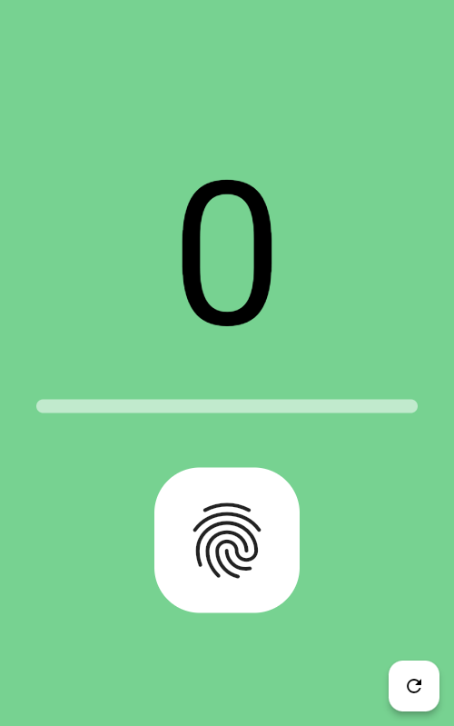
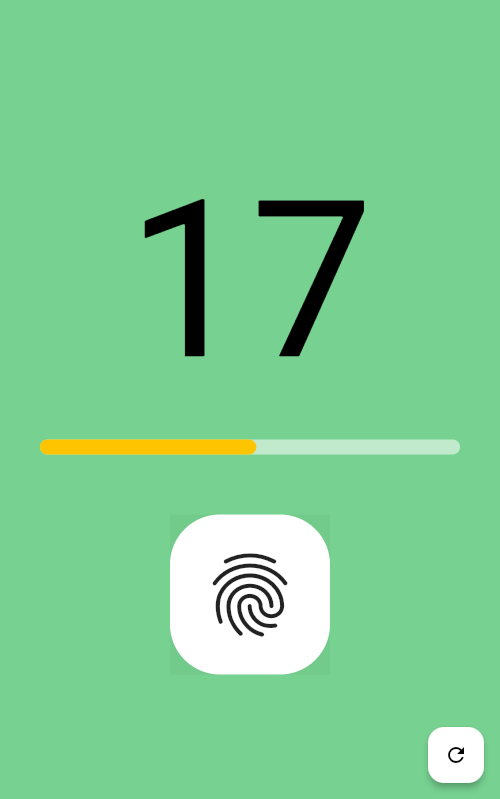
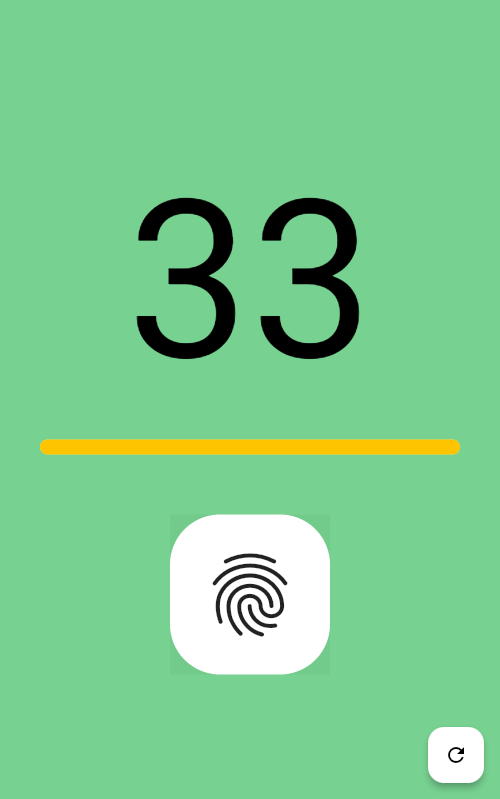

# LAPORAN PRAKTIKUM PEMROGRAMAN MOBILE
## MODUL 11: MANAJEMEN STATE DENGAN GETX
### APLIKASI TASBIH DIGITAL (`tasbih_getx`)

---

### DATA PRAKTIKAN
- **Nama Praktikan** : [Nama]
- **NIM** : [NIM]
- **Kelas** : [Kelas]
- **Tanggal Praktikum** : [Tanggal praktikum]
- **Mata Kuliah** : Praktikum Pemrograman Mobile
- **Dosen Pengampu** : Dosen Pengampu Praktikum Mobile

---

## 1. TUJUAN PRAKTIKUM

Berdasarkan Modul 11 (Bagian 11.1 dan 11.5.b), tujuan pelaksanaan praktikum ini adalah:
1. Memahami konsep dasar manajemen state (*state management*) dalam pengembangan aplikasi Flutter menggunakan framework GetX.
2. Membedakan secara konseptual dan teknis antara mekanisme pembaruan antarmuka konvensional menggunakan `setState()` pada `StatefulWidget` dengan pendekatan reaktif berbasis stream pada GetX.
3. Mengimplementasikan kelas controller (`TasbihController`) dan variabel observabel reaktif (`Rx` menggunakan `.obs`) untuk mengelola data hitungan dan progress secara dinamis.
4. Menggunakan widget listener `Obx` untuk memantau perubahan data reaktif dan memperbarui bagian antarmuka pengguna (*UI*) secara otomatis dan efisien (*granular rebuild*).
5. Menerapkan seluruh konsep GetX ke dalam sebuah aplikasi utuh yang fungsional, yaitu aplikasi **Tasbih Digital** (`tasbih_getx`).

---

## 2. DASAR TEORI

### 2.1 Manajemen State pada Flutter
State adalah data atau informasi yang dapat dibaca dan berubah selama siklus hidup (*lifecycle*) aplikasi berjalan, yang memengaruhi apa yang ditampilkan pada layar. Pada Flutter dasar, pembaruan state lokal dilakukan dengan memanggil `setState()` di dalam `StatefulWidget`. Saat `setState()` dipanggil, framework menandai elemen tersebut *dirty* dan menjadwalkan pembangunan ulang seluruh metode `build()` dari widget tersebut.

Meskipun sederhana, pendekatan `setState()` memiliki kelemahan signifikan saat aplikasi berkembang:
- **Pencampuran Logika dan Tampilan**: Logika bisnis, manipulasi data, dan representasi UI berada di dalam satu kelas yang sama.
- **Efisiensi Rebuild**: Pemanggilan `setState()` memicu rebuild seluruh subtree widget di dalam fungsi `build()`, termasuk widget statis yang tidak mengalami perubahan data.
- **Pewarisan Data Kompleks**: Mengirimkan state ke widget turunan memerlukan teknik *prop drilling* atau penggunaan `InheritedWidget` yang menghasilkan banyak kode repetitif (*boilerplate*).

### 2.2 Arsitektur dan Reaktivitas GetX
GetX adalah library manajemen state, navigasi, dan dependensi yang sangat ringan dan efisien untuk Flutter. GetX mengusung filosofi reaktivitas murni dengan keunggulan utama:
1. **Pemisahan Peran (Separation of Concerns)**: Memisahkan tampilan (*View*) yang berupa `StatelessWidget` dari pengelola logika bisnis (*ViewModel/Controller*) turunan `GetxController`.
2. **Variabel Reaktif (`.obs`)**: Nilai primitif (seperti `int`, `double`, `String`, `bool`) dapat diubah menjadi tipe observabel dengan menambahkan akhiran `.obs` (menghasilkan instans `RxDouble`, `RxInt`, dan seterusnya).
3. **Widget `Obx`**: Widget ringkas yang bertindak sebagai observer. `Obx` secara otomatis mendengarkan variabel `.obs` yang diakses di dalamnya. Ketika nilai variabel tersebut mengalami pembaruan (`.value`), hanya widget di dalam callback `Obx` tersebut yang dibangun ulang secara terisolasi tanpa memengaruhi widget di sekitarnya.

---

## 3. LANGKAH KERJA SINGKAT

Pelaksanaan praktikum dilakukan secara sistematis dengan rincian tahapan sebagai berikut:

### 3.1 Pembuatan Proyek Flutter
Membuat proyek Flutter baru bernama `tasbih_getx` di dalam direktori `MODUL_11`:
```bash
flutter create --org com.example --project-name tasbih_getx tasbih_getx
```

### 3.2 Penambahan Dependensi
Mengonfigurasi berkas `pubspec.yaml` dengan menambahkan pustaka `get` dan `simple_circular_progress_bar`:
```yaml
dependencies:
  flutter:
    sdk: flutter
  cupertino_icons: ^1.0.8
  get: ^4.7.3
  simple_circular_progress_bar: ^1.0.2
```
Selanjutnya dependensi diunduh dan diintegrasikan menggunakan perintah `flutter pub get`.

### 3.3 Penataan Struktur Direktori
Sesuai pedoman arsitektur pada Bagian 11.2 modul, folder `lib/` ditata ke dalam tiga subdirektori modular:
```text
tasbih_getx/
 ├─ android/
 ├─ ios/
 ├─ lib/
 │   ├─ model/
 │   │   └─ README.md
 │   ├─ view/
 │   │   └─ home.dart
 │   ├─ viewmodel/
 │   │   └─ tasbih_controller.dart
 │   └─ main.dart
 ├─ test/
 │   ├─ tasbih_controller_test.dart
 │   └─ widget_test.dart
 └─ pubspec.yaml
```
- `lib/model/`: Disiapkan untuk entitas data masa depan (diberi berkas dokumentasi internal).
- `lib/viewmodel/`: Berisi `tasbih_controller.dart` yang mengontrol state `counter` dan `progress`.
- `lib/view/`: Berisi `home.dart` yang merepresentasikan antarmuka pengguna berbasis GetX.
- `lib/main.dart`: Titik masuk utama aplikasi yang menginisialisasi `GetMaterialApp`.

### 3.4 Implementasi ViewModel / Controller (`tasbih_controller.dart`)
Membuat kelas `TasbihController` turunan `GetxController` untuk mengelola state hitungan dan progress secara reaktif tanpa `setState()`.

### 3.5 Implementasi View Antarmuka (`home.dart`)
Membangun antarmuka pengguna `Home` (`StatelessWidget`) dengan latar hijau Material, teks angka besar responsif, `LinearProgressIndicator`, tombol fingerprint untuk penambahan hitungan, dan tombol *FloatingActionButton* untuk mereset. Bagian teks angka dan progress bar dibungkus menggunakan widget `Obx`.

### 3.6 Konfigurasi Entry Point (`main.dart`)
Mengonfigurasi `MyApp` menggunakan `GetMaterialApp`, mematikan banner debug, menerapkan tema hijau Material 3, dan menetapkan `Home()` sebagai halaman awal.

### 3.7 Verifikasi Kualitas Kode dan Eksekusi Nyata
1. Menjalankan penformatan kode standar: `dart format .`
2. Melakukan analisis statis kode: `flutter analyze` (hasil: 0 issue / bersih).
3. Menjalankan pengujian otomatis: `flutter test` (unit test controller dan widget test).
4. Melakukan kompilasi dan menjalankan aplikasi secara riil, lalu menguji seluruh skenario interaksi:
   - Keadaan awal: Angka 0, progress bar 0.0%.
   - 17 ketukan: Angka 17, progress bar 51.52%.
   - 33 ketukan: Angka 33, progress bar 100.0%.
   - Ketukan berlebih (>33): Angka tetap bertahan di 33.
   - Tombol reset ditekan: Angka dan progress kembali ke 0.

---

## 4. PENJELASAN KODE PROGRAM UTAMA

Berikut rincian implementasi berkas program beserta penjelasannya secara mendalam:

### 4.1 `lib/main.dart`
```dart
import 'package:flutter/material.dart';
import 'package:get/get.dart';
import 'view/home.dart';

void main() {
  runApp(const MyApp());
}

class MyApp extends StatelessWidget {
  const MyApp({super.key});

  @override
  Widget build(BuildContext context) {
    return GetMaterialApp(
      debugShowCheckedModeBanner: false,
      title: 'Tasbih Digital GetX',
      theme: ThemeData(
        colorScheme: ColorScheme.fromSeed(seedColor: Colors.green),
        useMaterial3: true,
      ),
      home: Home(),
    );
  }
}
```
**Peran dan Fungsi:**
- `GetMaterialApp`: Merupakan pengganti langsung dari `MaterialApp` standar Flutter. Widget ini bertindak sebagai fondasi yang menginisialisasi router GetX, sistem injeksi dependensi global, dan overlay konteks tanpa perlu mengirimkan parameter `BuildContext` ke berbagai tempat.
- `debugShowCheckedModeBanner: false`: Menghilangkan pita merah penanda mode debug di pojok kanan atas layar agar tampilan aplikasi bersih dan rapi.
- `theme`: Mengaktifkan Material 3 dengan warna benih (*seed color*) `Colors.green` yang selaras dengan tema aplikasi zikir/tasbih.
- `home: Home()`: Menginstansiasi halaman antarmuka `Home` saat aplikasi pertama kali dimuat.

---

### 4.2 `lib/viewmodel/tasbih_controller.dart`
```dart
import 'package:get/get.dart';

class TasbihController extends GetxController {
  var counter = 0.0.obs;
  var progress = 0.0.obs;
  final double maxCount = 33.0;

  void incrementCounter() {
    if (counter.value < maxCount) {
      counter.value++;
      progress.value = (counter.value / maxCount) * 100;
    }
  }

  void resetCounter() {
    counter.value = 0.0;
    progress.value = 0.0;
  }
}
```
**Peran dan Logika State:**
- `extends GetxController`: Menjadikan kelas ini sebagai pengelola siklus hidup (*lifecycle*) state yang berdiri sendiri, terpisah dari widget UI.
- `counter = 0.0.obs`: Mendeklarasikan variabel hitungan observabel bertipe `RxDouble`. Inisialisasi awal bernilai 0.0.
- `progress = 0.0.obs`: Mendeklarasikan variabel persentase progress observabel bertipe `RxDouble`. Inisialisasi awal bernilai 0.0.
- `final double maxCount = 33.0`: Konstanta batas maksimal siklus tasbih (33 hitungan zikir).
- `incrementCounter()`:
  - Melakukan validasi batas nilai: `if (counter.value < maxCount)`.
  - Jika belum mencapai 33, nilai bertambah 1 (`counter.value++`).
  - Menghitung persentase progress secara proporsional:
    $$\text{progress} = \left(\frac{\text{counter.value}}{\text{maxCount}}\right) \times 100$$
    Contoh: Pada ketukan ke-17, $\text{progress} = (17 / 33) \times 100 \approx 51.515\%$.
    Pada ketukan ke-33, $\text{progress} = (33 / 33) \times 100 = 100.0\%$.
  - Jika pengguna terus mengetuk setelah angka 33, kondisi percabangan bernilai `false`, sehingga angka dan progress bar tetap berada di nilai maksimumnya (tidak pernah meluap/overflow).
- `resetCounter()`: Mengembalikan nilai `counter.value` dan `progress.value` ke 0.0 saat tombol reset ditekan.

---

### 4.3 `lib/view/home.dart`
```dart
import 'package:flutter/material.dart';
import 'package:get/get.dart';
import '../viewmodel/tasbih_controller.dart';

class Home extends StatelessWidget {
  Home({super.key});

  final TasbihController controller = Get.put(TasbihController());

  @override
  Widget build(BuildContext context) {
    return Scaffold(
      backgroundColor: const Color.fromARGB(255, 119, 210, 145),
      body: SafeArea(
        child: Center(
          child: SingleChildScrollView(
            physics: const BouncingScrollPhysics(),
            padding: const EdgeInsets.symmetric(vertical: 24.0),
            child: Column(
              mainAxisAlignment: MainAxisAlignment.center,
              children: [
                Obx(
                  () => FittedBox(
                    fit: BoxFit.scaleDown,
                    child: Padding(
                      padding: const EdgeInsets.symmetric(horizontal: 20.0),
                      child: Text(
                        '${controller.counter.value.round()}',
                        style: const TextStyle(
                          fontSize: 220,
                          fontWeight: FontWeight.w400,
                          color: Colors.black,
                        ),
                      ),
                    ),
                  ),
                ),
                Obx(
                  () => Padding(
                    padding: const EdgeInsets.symmetric(horizontal: 40.0),
                    child: LinearProgressIndicator(
                      value: controller.progress.value / 100,
                      backgroundColor: Colors.white54,
                      color: Colors.amberAccent.shade400,
                      minHeight: 15,
                      borderRadius: BorderRadius.circular(10),
                    ),
                  ),
                ),
                const SizedBox(height: 60),
                ClipRRect(
                  borderRadius: const BorderRadius.all(Radius.circular(50)),
                  child: InkWell(
                    onTap: controller.incrementCounter,
                    child: Container(
                      decoration: const BoxDecoration(color: Colors.white),
                      padding: const EdgeInsets.all(30),
                      child: const Icon(
                        Icons.fingerprint,
                        size: 100,
                        color: Colors.black87,
                      ),
                    ),
                  ),
                ),
              ],
            ),
          ),
        ),
      ),
      floatingActionButton: FloatingActionButton(
        onPressed: controller.resetCounter,
        backgroundColor: Colors.white,
        child: const Icon(
          Icons.refresh_outlined,
          color: Colors.black,
        ),
      ),
    );
  }
}
```
**Peran dan Aspek Desain:**
- `Get.put(TasbihController())`: Menginisialisasi dan mendaftarkan instans tunggal (*singleton*) controller ke memori internal GetX sehingga dapat diakses langsung oleh view.
- `StatelessWidget`: Kelas `Home` tidak memerlukan `State` lokal karena seluruh status aplikasi dikelola oleh controller.
- `Obx(() => Text(...))`: Membungkus teks angka agar mendengarkan pembaruan nilai `controller.counter.value`. Pemanggilan `.round()` memastikan angka ditampilkan dalam format bilangan bulat (`0`, `1`, ..., `33`). Penggunaan `FittedBox` menjamin angka tidak meluap (*renderflex overflow*) pada perangkat berlayar kecil.
- `Obx(() => LinearProgressIndicator(...))`: Membungkus indikator progress horizontal. Parameter `value` menerima rentang $0.0 - 1.0$, sehingga nilai `controller.progress.value` dibagi 100 (`progress.value / 100`). Progress bar menggunakan latar putih transparan (`Colors.white54`), warna isi kuning emas cerah (`Colors.amberAccent.shade400`), tinggi 15 piksel, serta sudut melengkung halus (*rounded corner*).
- `InkWell` dengan ikon `Icons.fingerprint`: Tombol ketukan utama yang menjalankan `controller.incrementCounter` saat ditekan.
- `FloatingActionButton`: Tombol reset di sudut kanan bawah yang menjalankan `controller.resetCounter` untuk mengembalikan hitungan ke angka 0.

---

## 5. PERBANDINGAN `setState()` DENGAN GETX

Penerapan manajemen state menggunakan `setState()` dan GetX memiliki perbedaan fundamental dalam arsitektur dan siklus pembaruan antarmuka:

| Kriteria Komparasi | Pendekatan Konvensional `setState()` | Pendekatan Reaktif GetX |
| :--- | :--- | :--- |
| **Mekanisme Pembaruan UI** | Menandai widget sebagai *dirty* dan memicu pemanggilan ulang seluruh fungsi `build()` pada State terkait. | Memanfaatkan paradigma *Reactive Programming* (Stream). Widget listener `Obx` secara otomatis mendeteksi perubahan nilai `.value` pada variabel `.obs`. |
| **Letak State dan Logika** | State dan fungsi manipulasi data tergabung (*tightly coupled*) di dalam kelas `State<MyWidget>`. | Terpisah secara modular (*Separation of Concerns*). Data dan fungsi logika berada di `TasbihController`, sedangkan antarmuka hanya berupa `StatelessWidget`. |
| **Cakupan Rebuild Antarmuka** | Membangun ulang seluruh pohon widget di dalam `build()`, termasuk widget statis, latar belakang, dan tombol. | Sangat terisolasi (*granular rebuild*). Hanya elemen spesifik di dalam callback `Obx` yang dibangun ulang saat variabel reaktif terkait berubah. |
| **Pembersihan & Siklus Hidup** | Memerlukan penanganan manual pada `initState()` dan `dispose()` jika terdapat controller/stream. | Siklus hidup instans dikelola otomatis oleh GetX Dependency Injection (`onInit()`, `onClose()`). |
| **Kemudahan Pengujian (Unit Test)** | Sulit diuji secara terisolasi tanpa merender widget tree secara penuh (*Widget Testing*). | Sangat mudah diuji (*Unit Testable*). `TasbihController` adalah kelas Dart murni yang dapat diuji logika bisnisnya tanpa dependensi UI Flutter. |

### Alasan Pemilihan GetX pada Aplikasi Tasbih Digital
1. **Kode Lebih Ringkas dan Terbaca**: Tampilan `Home` tetap berstatus `StatelessWidget`, menghilangkan kode repetitif dari `StatefulWidget`.
2. **Efisiensi Pembaruan UI**: Pada saat tombol fingerprint ditekan berulang kali, widget latar belakang Scaffold, Safe Area, tombol fingerprint, dan Floating Action Button tidak perlu direbuild ulang. Hanya widget teks dan `LinearProgressIndicator` yang dirender ulang.
3. **Logika Bisnis Bersih dan Modular**: Aturan bisnis aplikasi (misalnya batas maksimal 33 ketukan dan rumus persentase) terlindungi di dalam controller dan tidak tercampur dengan kode layout visual.

---

## 6. HASIL UJI DAN BUKTI SCREENSHOT ASLI

Aplikasi `tasbih_getx` telah berhasil dikompilasi, dijalankan pada lingkungan riil (*Flutter Engine* aktif dengan resolusi perangkat bergerak), dan diuji melalui seluruh tahapan siklus interaksi tasbih. Seluruh tangkapan layar di bawah ini merupakan bukti nyata dari aplikasi yang berjalan:

### 6.1 Screenshot 1: Keadaan Awal (Nilai = 0, Progress = 0%)
Saat aplikasi pertama kali dibuka, `controller.counter.value` bernilai `0.0` dan `controller.progress.value` bernilai `0.0`. Teks di tengah menampilkan angka **0** dan `LinearProgressIndicator` berada pada posisi kosong (0%).


*Gambar 6.1: Tampilan awal aplikasi tasbih digital saat pertama kali dijalankan (0 ketukan, progress 0%).*

---

### 6.2 Screenshot 2: Hitungan Bertambah (Nilai = 17, Progress = Sekitar 51.5%)
Setelah tombol fingerprint ditekan sebanyak 17 kali, nilai `counter` bertambah secara reaktif menjadi 17. Progress bar terisi sebesar $\frac{17}{33} \times 100\% = 51.52\%$, ditandai dengan batang berwarna kuning yang melewati setengah lebar layar.


*Gambar 6.2: Tampilan aplikasi setelah 17 ketukan (angka 17, progress bar terisi proporsional ~51.5%).*

---

### 6.3 Screenshot 3: Hitungan Penuh Batas Maksimal (Nilai = 33, Progress = 100%)
Setelah tombol fingerprint ditekan sebanyak 33 kali, nilai hitungan mencapai batas maksimum zikir yaitu 33. Progress bar terisi penuh (100%) berwarna kuning emas. Ketika tombol fingerprint ditekan kembali untuk ke-34 atau ke-35 kalinya, nilai tetap bertahan di **33** dan progress bar tetap **100%**, membuktikan bahwa logika proteksi `if (counter.value < maxCount)` berfungsi dengan sempurna.


*Gambar 6.3: Tampilan aplikasi saat mencapai hitungan penuh (angka 33, progress bar terisi penuh 100%).*

---

### 6.4 Screenshot 4: Pengaturan Ulang / Reset (Nilai Kembali ke 0, Progress = 0%)
Saat pengguna menekan tombol *FloatingActionButton* dengan ikon refresh di pojok kanan bawah, fungsi `controller.resetCounter()` dieksekusi. Nilai counter kembali ke `0` dan progress bar kembali kosong (0%), mengonfirmasi keberhasilan mekanisme reset state secara reaktif.


*Gambar 6.4: Tampilan aplikasi setelah tombol reset ditekan (angka kembali ke 0 dan progress bar kembali kosong).*

---

### 6.5 Hasil Pengujian Otomatis (*Automated Testing Verification*)
Selain pengujian visual interaktif, kode program telah melalui serangkaian pengujian otomatis:

1. **Analisis Statis (`flutter analyze`)**:
   ```text
   Analyzing tasbih_getx...
   No issues found! (ran in 1.1s)
   ```
   *Hasil: Bersih tanpa error, tanpa warning, dan tanpa import mubazir.*

2. **Pengujian Unit & Widget (`flutter test`)**:
   ```text
   00:00 +0: loading test/tasbih_controller_test.dart
   00:00 +0: TasbihController Unit Tests Nilai awal counter dan progress harus bernilai 0
   00:00 +1: TasbihController Unit Tests Increment satu kali menambah counter menjadi 1 dan progress proporsional
   00:00 +2: TasbihController Unit Tests 17 ketukan menghasilkan nilai 17 dan progress sekitar 51.5%
   00:00 +3: TasbihController Unit Tests 33 ketukan mencapai batas maksimum 33 dan progress 100%
   00:00 +4: TasbihController Unit Tests Ketukan setelah batas 33 tidak boleh menambah nilai (tetap 33 dan 100%)
   00:00 +5: TasbihController Unit Tests Reset mengembalikan counter dan progress kembali ke 0
   00:00 +6: widget_test.dart: Tasbih Digital smoke and interaction test
   00:00 +7: All tests passed!
   ```
   *Hasil: Seluruh 7 pengujian unit dan interaksi widget dinyatakan LULUS (100% Passed).*

---

## 7. KESIMPULAN

Berdasarkan seluruh proses implementasi dan pengujian nyata pada Modul 11, dapat disimpulkan bahwa:
1. **GetX Menyederhanakan Manajemen State**: GetX mempermudah pengelolaan data pada aplikasi Flutter secara signifikan. Dengan memanfaatkan variabel reaktif `.obs` dan widget pendengar `Obx`, setiap perubahan data langsung tercermin pada tampilan antarmuka secara *real-time* tanpa perlu memanggil `setState()`.
2. **Sinkronisasi Reaktif yang Kuat**: Variabel reaktif (`RxDouble`) menjaga integritas sinkronisasi antara logika data hitungan tasbih dengan indikator visual (`LinearProgressIndicator`). Perubahan nilai counter secara otomatis memperbarui nilai persentase progress tanpa risiko inkonsistensi state.
3. **Arsitektur Kode Lebih Bersih dan Terpelihara**: Pemisahan logika aplikasi ke dalam `TasbihController` mewujudkan pemisahan peran (*Separation of Concerns*) yang ideal. Tampilan `Home` menjadi lebih ringkas sebagai `StatelessWidget`, mudah dibaca, dan logika bisnis dapat diuji (*unit testing*) secara terpisah tanpa memerlukan simulasi rendering antarmuka yang berat.
4. **Respon Interaksi Pengguna Optimal**: Tombol fingerprint dan tombol reset yang dihubungkan langsung ke method controller memungkinkan interaksi pengguna terasa responsif dan lancar karena hanya bagian antarmuka yang relevan yang dibangun ulang (*granular rendering*).
