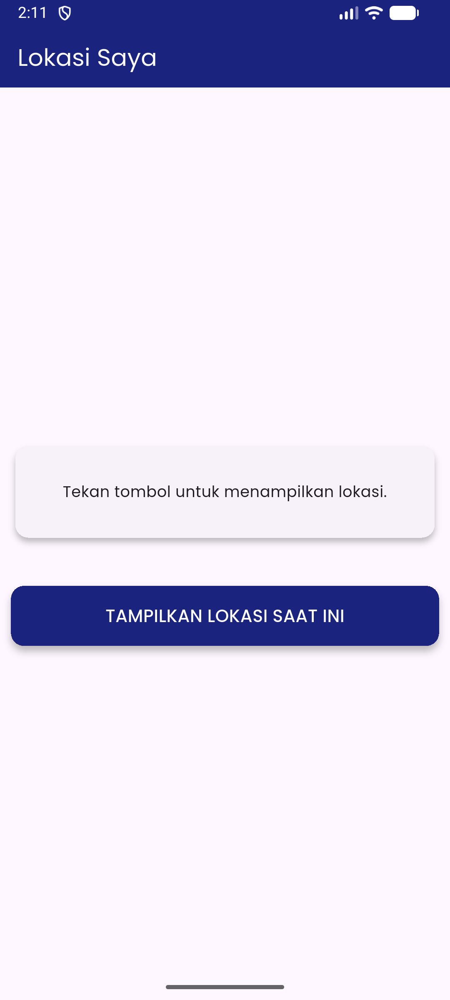
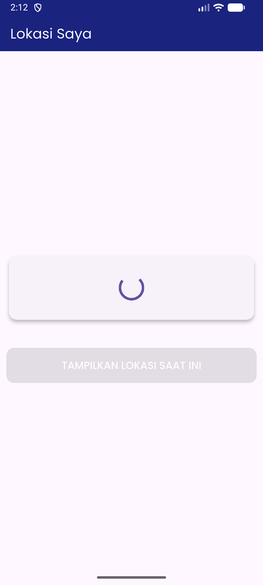
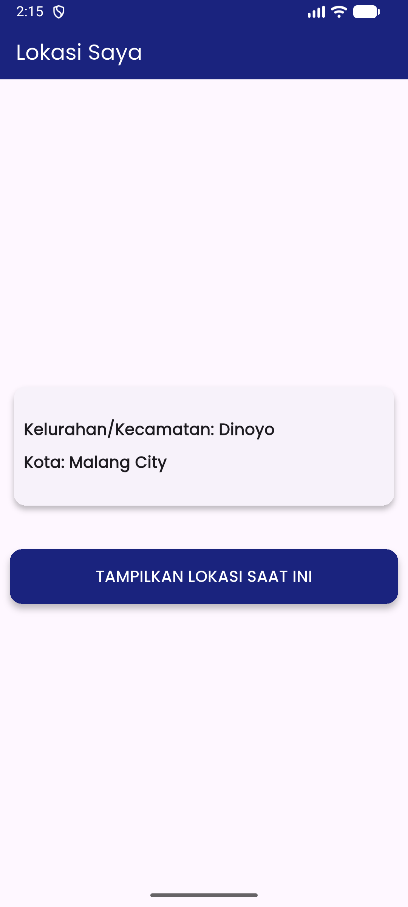
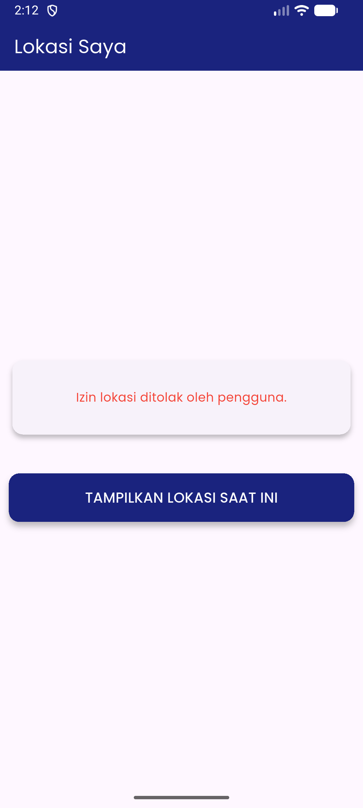
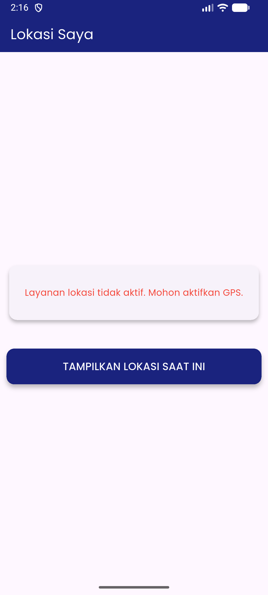
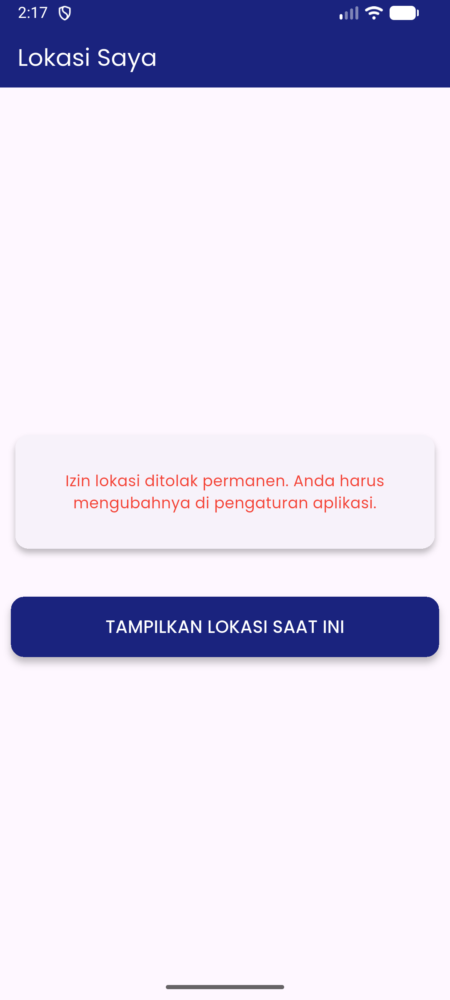

# LAPORAN PRAKTIKUM PEMROGRAMAN MOBILE
## MODUL XII: AKSES LOKASI DENGAN GPS DI FLUTTER

---

### A. Cover

* **Judul Laporan:** Praktikum Modul XII – Akses Lokasi dengan GPS di Flutter
* **Mata Kuliah:** Praktikum Pemrograman Mobile
* **Nama Modul:** Modul XII - Akses Lokasi dengan GPS di Flutter
* **Nama Aplikasi / Proyek:** `lokasi_flutter`
* **Nama Mahasiswa:** [Placeholder: Nama Mahasiswa]
* **NIM:** [Placeholder: NIM Mahasiswa]
* **Kelas / Kelompok:** [Placeholder: Kelas / Kelompok]
* **Tanggal Pelaksanaan:** [Placeholder: Tanggal Praktikum]
* **Dosen Pengampu / Asisten:** [Placeholder: Nama Dosen / Asisten Praktikum]

---

### B. Tujuan

Tujuan pelaksanaan praktikum Modul XII ini adalah sebagai berikut:
1. **Memahami Konsep Pengambilan Lokasi GPS:** Mempelajari arsitektur dan mekanisme perangkat mobile dalam memperoleh posisi geografis (garis lintang/latitude dan garis bujur/longitude) memanfaatkan sensor GPS internal perangkat.
2. **Pemanfaatan Paket `geolocator`:** Mengintegrasikan pustaka `geolocator` pada Flutter untuk memeriksa status layanan lokasi (GPS hardware), menangani alur perizinan (runtime permissions), serta meminta koordinat presisi tinggi perangkat saat tombol ditekan.
3. **Penerapan Reverse Geocoding dengan `geocoding`:** Mengonversi data koordinat numerik latitude dan longitude menjadi representasi alamat yang dapat dimengerti manusia (*human-readable address*), seperti tingkat kelurahan/kecamatan (*subLocality*) dan kabupaten/kota (*subAdministrativeArea*).
4. **Penanganan Izin dan Kondisi Galat (*Permission & Error Handling*):** Mengelola siklus izin akses lokasi pada platform Android (status *denied*, *deniedForever*, dan *granted*) serta menyediakan penanganan kesalahan (*try-catch-finally*) jika GPS dinonaktifkan atau geocoder gagal merespons.
5. **Membangun Antarmuka Responsif dan Interaktif:** Menerapkan `StatefulWidget` dengan pembaruan *state* berbasis `setState()` guna menampilkan transisi antarmuka pengguna secara mulus antara kondisi awal (*idle*), sedang memproses (*loading indicator*), berhasil menampilkan data alamat, maupun menampilkan pesan galat berwarna merah secara informatif.

---

### C. Langkah Kerja Singkat

Praktikum dilaksanakan secara runtut dengan tahapan-tahapan teknis berikut:

#### 1. Pembuatan Proyek Flutter
Proyek Flutter baru diinisialisasi melalui perintah terminal:
```bash
flutter create lokasi_flutter
```
Proyek ini dikonfigurasi dengan target utama Android, menggunakan arsitektur sederhana dengan titik masuk utama kode aplikasi berada di `lib/main.dart`.

#### 2. Penambahan Dependensi pada `pubspec.yaml`
Dependensi yang didefinisikan pada berkas `pubspec.yaml` adalah:
* `google_fonts: ^6.1.0` (digunakan untuk tipografi Poppins).
* `geolocator: ^10.1.0` (disesuaikan dari acuan modul `^7.7.0`).
* `geocoding: ^4.0.0` (disesuaikan dari acuan modul `^3.0.0`).

> **Catatan Penyesuaian Dependensi & Alasan Teknis:**
> * **`geolocator`:** Versi `^7.7.0` (dirilis tahun 2021) menggunakan pustaka bawaan `geolocator_android 2.1.0` yang belum menyertakan deklarasi `namespace` pada berkas Gradle. Pada Android Gradle Plugin 8+ / Gradle 9+ dan SDK Android 36 yang terpasang pada lingkungan pengembangan modern, deklarasi `namespace` bersifat wajib. Tanpa namespace, build Gradle Android gagal (*"Namespace not specified"*). Oleh karena itu, dependensi dinaikkan ke versi `^10.1.0` (terselesaikan ke 10.1.1) yang telah mendukung AGP 8+ dengan tetap mempertahankan kompatibilitas API penuh terhadap fungsi `isLocationServiceEnabled()`, `checkPermission()`, `requestPermission()`, dan `getCurrentPosition(desiredAccuracy: LocationAccuracy.high)`.
> * **`geocoding`:** Versi `^3.0.0` dikompilasi dengan target `compileSdk 33`. Saat diverifikasi oleh Android Gradle Plugin, proses build gagal pada tahap `checkDebugAarMetadata` karena pustaka transitif AndroidX (`androidx.fragment:1.7.1`, `androidx.core:1.13.1`, dll.) mewajibkan `compileSdk` minimum versi 34 atau lebih baru. Dependensi `geocoding` disesuaikan ke versi `^4.0.0` yang dikompilasi terhadap SDK Android 35+. Versi `4.0.0` tetap mempertahankan fungsi *top-level* `placemarkFromCoordinates(lat, lon)` sesuai modul praktikum (berbeda dengan versi `5.0.0+` yang melakukan perubahan besar/*breaking change* dengan mewajibkan instansiasi kelas `Geocoding()`).

#### 3. Konfigurasi Izin Lokasi di `android/app/src/main/AndroidManifest.xml`
Izin akses lokasi ditambahkan di bawah elemen akar `<manifest>` sebelum elemen `<application>`:
```xml
<manifest xmlns:android="http://schemas.android.com/apk/res/android">
    <uses-permission android:name="android.permission.ACCESS_FINE_LOCATION" />
    <uses-permission android:name="android.permission.ACCESS_COARSE_LOCATION" />
    <application
        android:label="Lokasi Saya"
        ...
```
Izin `ACCESS_FINE_LOCATION` diperlukan untuk memperoleh akurasi posisi tinggi via GPS satelit, sedangkan `ACCESS_COARSE_LOCATION` digunakan untuk perkiraan lokasi berbasis seluler/Wi-Fi.

#### 4. Pembuatan Antarmuka Pengguna (UI)
Antarmuka dibangun di dalam `lib/main.dart` menggunakan komponen widget standar:
* **`MaterialApp` & `ThemeData`:** Menggunakan skema warna indigo (`Colors.indigo`) dengan `textTheme` dari Google Fonts Poppins (`GoogleFonts.poppinsTextTheme`).
* **`Scaffold`:** Menyediakan kerangka dasar halaman.
* **`AppBar`:** Diberi judul "Lokasi Saya" dengan teks putih dan warna latar `#1A237E`.
* **`Padding` & `Column`:** Memberikan jarak luar sebesar 10.0 dan menyusun konten secara vertikal di tengah layar (`mainAxisAlignment: MainAxisAlignment.center`) serta melebar penuh (`crossAxisAlignment: CrossAxisAlignment.stretch`). Dibungkus `SingleChildScrollView` untuk memastikan tidak terjadi luapan visual (*overflow*) pada layar berukuran kecil.
* **`Card`:** Kartu informasi dengan `elevation: 4.0`, sudut membulat `borderRadius: BorderRadius.circular(12.0)`, serta *padding* internal 32.0 (vertikal) dan 10.0 (horizontal).
* **`ElevatedButton`:** Tombol pemicu aksi bertuliskan `"TAMPILKAN LOKASI SAAT INI"` dengan warna `#1A237E`, teks putih ukuran 16, elevasi 5.0, dan sudut membulat 12.0. Tombol otomatis dinonaktifkan (`onPressed: _isLoading ? null : _getLocation`) ketika aplikasi sedang melakukan pengambilan lokasi.

#### 5. Implementasi Fungsi `_getLocation()` dan State Management
Pada `_LocationScreenState`, disediakan 4 variabel status:
* `String? _kecamatan`: Menyimpan nama kecamatan/kelurahan yang didapatkan dari reverse geocoding.
* `String? _kota`: Menyimpan nama kota/kabupaten yang didapatkan dari reverse geocoding.
* `bool _isLoading = false`: Menandakan status proses sedang berjalan untuk menampilkan spinner dan menonaktifkan tombol.
* `String? _errorMessage`: Menyimpan pesan galat jika terjadi kendala pada layanan, izin, atau jaringan.

Alur eksekusi `Future<void> _getLocation() async` berjalan dengan tahapan:
1. **Inisialisasi Status:** Memanggil `setState()` untuk mengatur `_isLoading = true` serta mengosongkan `_errorMessage`, `_kecamatan`, dan `_kota`.
2. **Pengecekan Layanan GPS:** Memeriksa `Geolocator.isLocationServiceEnabled()`. Jika layanan GPS mati, dilemparkan pengecualian: `"Layanan lokasi tidak aktif. Mohon aktifkan GPS."`.
3. **Pemeriksaan dan Permintaan Izin:**
   * Memeriksa status dengan `Geolocator.checkPermission()`.
   * Jika status bernilai `LocationPermission.denied`, aplikasi meminta izin kepada pengguna via `Geolocator.requestPermission()`.
   * Jika pengguna menolak izin, dilemparkan pengecualian: `"Izin lokasi ditolak oleh pengguna."`.
   * Jika izin berstatus `LocationPermission.deniedForever`, dilemparkan pengecualian: `"Izin lokasi ditolak permanen. Anda harus mengubahnya di pengaturan aplikasi."`.
4. **Pengambilan Koordinat GPS:** Memanggil `Geolocator.getCurrentPosition(desiredAccuracy: LocationAccuracy.high)` untuk memperoleh koordinat latitude dan longitude terkini.
5. **Reverse Geocoding:** Memanggil fungsi `placemarkFromCoordinates(position.latitude, position.longitude)`.
   * Jika daftar `placemarks` tidak kosong, data pertama (`placemarks[0]`) diekstrak.
   * `_kecamatan` diambil dari `place.subLocality` (dengan *fallback* ke `place.locality` atau `"-"` untuk mencegah teks `"null"`).
   * `_kota` diambil dari `place.subAdministrativeArea` (dengan *fallback* ke `place.administrativeArea` atau `"-"`).
   * Jika daftar kosong, dilemparkan pengecualian: `"Tidak dapat menemukan informasi alamat."`.
6. **Blok `catch` & `finally`:**
   * Semua kegagalan ditangkap pada blok `catch (e)` dan disimpan ke dalam `_errorMessage` setelah membersihkan awalan `"Exception: "`.
   * Blok `finally` memastikan bahwa `_isLoading` dikembalikan menjadi `false`.
   * Setiap pemanggilan `setState()` setelah operasi *asynchronous* (`await`) diproteksi dengan pengecekan `if (!mounted) return;` guna mencegah kebocoran memori atau error saat widget telah dilepas dari pohon elemen.

> **Penjelasan Variasi Hasil Geocoding:**
> Pembagian administratif hasil reverse geocoding bergantung pada penyedia data geocoder sistem operasi (Google Play Services / Android Geocoder). Nilai `subLocality` umumnya merepresentasikan kelurahan atau kecamatan di Indonesia, sedangkan `subAdministrativeArea` merepresentasikan tingkat kota atau kabupaten. Namun, kelengkapan data alamat bisa bervariasi bergantung pada ketersediaan data pemetaan pada koordinat yang diminta.

---

### D. Screenshot Hasil Pengujian

Pengujian dilakukan secara nyata (*real execution*) menggunakan emulator Android dengan sistem Android API 37 (`sdk gphone64 x86_64`) dan koordinat pengujian yang disimulasikan sesuai kondisi pada modul.

Berikut adalah dokumentasi hasil tangkapan layar pengujian untuk seluruh kondisi:

#### 1. Kondisi Awal (Sebelum Lokasi Diambil)


*Keterangan Gambar 1:*
Tampilan antarmuka saat aplikasi pertama kali dibuka. Kartu informasi menampilkan teks placeholder *"Tekan tombol untuk menampilkan lokasi."*. Tombol `"TAMPILKAN LOKASI SAAT INI"` berada dalam kondisi aktif dan siap ditekan.

---

#### 2. Kondisi Loading (Sedang Memproses Pengambilan Lokasi)


*Keterangan Gambar 2:*
Tampilan saat tombol ditekan dan aplikasi sedang berkomunikasi dengan GPS serta layanan reverse geocoding. Kartu informasi menampilkan animasi perputaran `CircularProgressIndicator`, dan tombol di bawahnya dinonaktifkan secara otomatis untuk mencegah penekanan ganda.

---

#### 3. Kondisi Berhasil (Lokasi Berhasil Ditampilkan)


*Keterangan Gambar 3:*
Hasil pengujian ketika GPS aktif, izin lokasi diberikan, dan koordinat berhasil diubah menjadi alamat melalui reverse geocoding. Kartu menampilkan data kelurahan/kecamatan (*"Dinoyo"*) dan kota (*"Malang City"* / Kota Malang) dengan tipografi tebal ukuran 16 sesuai contoh modul.

---

#### 4. Kondisi Galat (Pesan Error Izin Ditolak Pengguna)


*Keterangan Gambar 4:*
Tampilan ketika pengguna memilih opsi *"Don't allow"* pada dialog izin sistem. Aplikasi menangkap status penolakan tersebut dan menampilkan pesan galat berwarna merah di tengah kartu: *"Izin lokasi ditolak oleh pengguna."*.

---

#### 5. Kondisi Galat Tambahan Terverifikasi

| Pengujian Tambahan | Tangkapan Layar | Keterangan |
| :--- | :---: | :--- |
| **Layanan GPS Nonaktif** |  | Ketika pengaturan lokasi perangkat dimatikan (`location_mode 0`), aplikasi mendeteksi kegagalan layanan dan menampilkan pesan: *"Layanan lokasi tidak aktif. Mohon aktifkan GPS."*. |
| **Izin Ditolak Permanen** |  | Ketika izin lokasi ditolak secara permanen (*deniedForever* / *user-fixed*), aplikasi menampilkan instruksi: *"Izin lokasi ditolak permanen. Anda harus mengubahnya di pengaturan aplikasi."*. |

---

### E. Kesimpulan

Berdasarkan implementasi kode dan serangkaian pengujian langsung yang telah dilaksanakan, dapat disimpulkan bahwa:
1. **Mekanisme *On-Demand Location Access*:** Aplikasi Flutter berhasil mengakses koordinat GPS perangkat saat pengguna menekan tombol `"TAMPILKAN LOKASI SAAT INI"`. Pendekatan ini merupakan *single/on-demand location fetching*, bukan pelacakan lokasi latar belakang (*continuous background tracking*), sehingga sangat efisien dalam penggunaan daya baterai perangkat.
2. **Integrasi Paket `geolocator` dan `geocoding`:** Kolaborasi kedua pustaka ini memungkinkan alur end-to-end yang solid: mulai dari verifikasi hardware GPS, penanganan dialog izin Android (runtime permissions), akuisisi koordinat latitude/longitude dengan akurasi tinggi, hingga konversi koordinat menjadi nama wilayah administratif (kecamatan dan kota) yang mudah dipahami pengguna.
3. **Pembaruan Antarmuka Reaktif dengan `setState()`:** Penggunaan `StatefulWidget` dan metode `setState()` terbukti efektif dalam mengendalikan status aplikasi (`_isLoading`, `_kecamatan`, `_kota`, dan `_errorMessage`). Setiap perubahan status secara instan merekonstruksi komponen UI terkait, memastikan umpan balik visual (mulai dari placeholder awal, indikator loading, hasil alamat, hingga pesan error) tersaji secara tepat dan responsif.
4. **Ketahanan Aplikasi (*Robustness*):** Penanganan galat terstruktur melalui blok `try-catch-finally` dan pengecekan properti `mounted` memastikan aplikasi tidak mengalami *crash* saat menghadapi situasi kegagalan (seperti GPS mati, izin ditolak, penolakan permanen, atau kegagalan jaringan geocoding).

