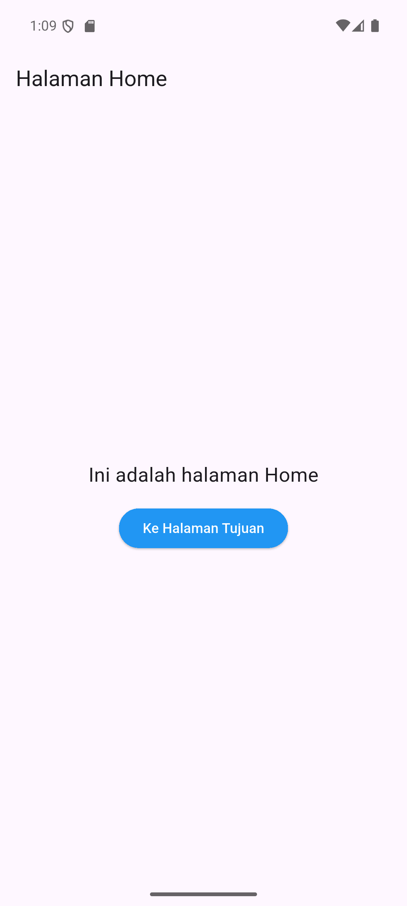
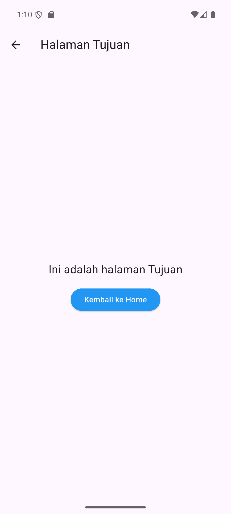
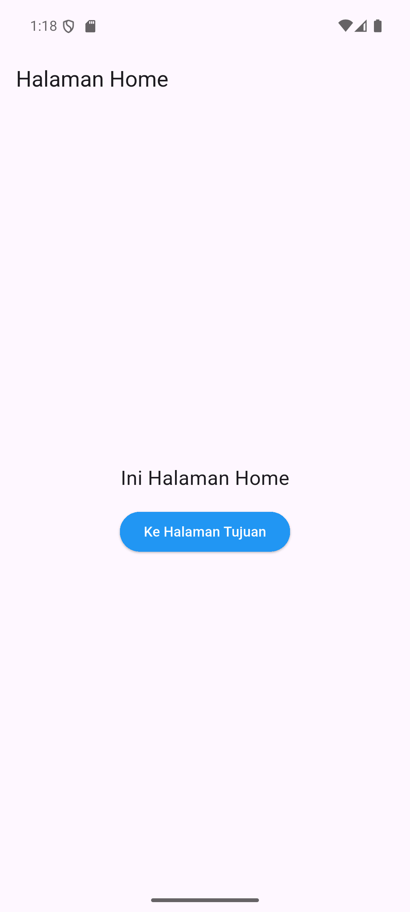
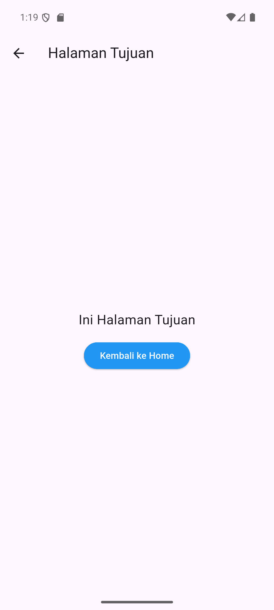
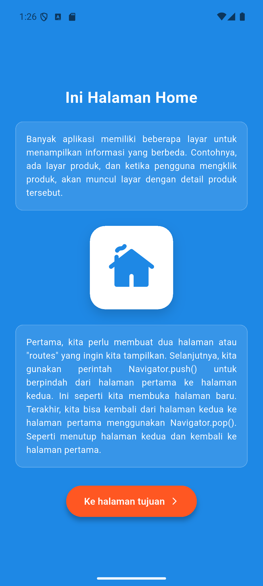
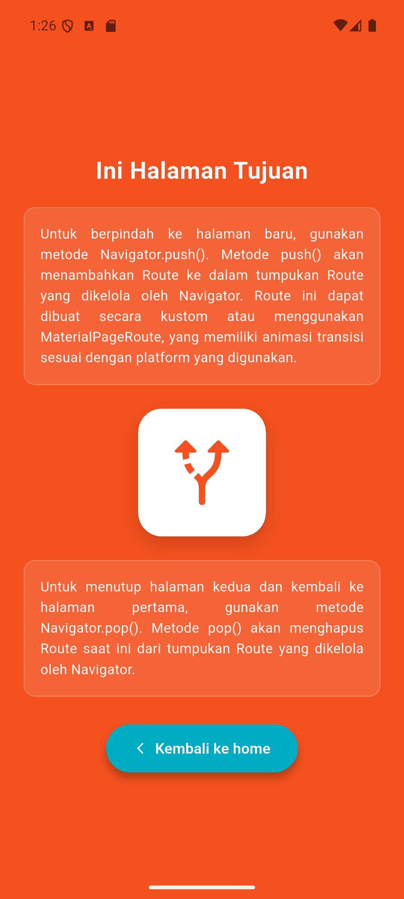

# LAPORAN PRAKTIKUM MOBILE PROGRAMMING
## MODUL VII: NAVIGASI ANTAR HALAMAN MENGGUNAKAN MATERIALPAGEROUTE DAN NAMED ROUTE

---

### Identitas Mahasiswa (Cover)
- **Judul Praktikum** : Navigasi Antar Halaman Menggunakan MaterialPageRoute dan Named Route
- **Mata Kuliah**     : Praktikum Mobile Programming
- **Nama**            : [Nama Mahasiswa]
- **NIM**             : [NIM Mahasiswa]
- **Kelas**           : [Kelas Mahasiswa]
- **Tanggal**         : 25 September 2026

---

## 1. Tujuan Praktikum
1. Memahami konsep dasar sistem navigasi dan routing antar halaman pada framework Flutter.
2. Mengimplementasikan navigasi langsung menggunakan `Navigator.push()` dengan `MaterialPageRoute` dan `Navigator.pop()`.
3. Mengimplementasikan navigasi terpusat berbasis rute bernama (*Named Route*) menggunakan `Navigator.pushNamed()` dan `Navigator.pop()`.
4. Mendaftarkan peta rute (*route table*) pada properti `routes` dan menentukan `initialRoute` pada `MaterialApp`.
5. Mendemonstrasikan dan menganalisis mekanisme tumpukan (*stack*) pada perpindahan halaman serta menyelesaikan tugas pembuatan aplikasi multi-halaman interaktif.

---

## 2. Dasar Teori Singkat
Dalam Flutter, sistem navigasi antar halaman dikelola oleh widget **Navigator**. Navigator bekerja dengan prinsip struktur data **Stack (LIFO - Last In, First Out)**:
- **`Navigator.push()` / `Navigator.pushNamed()`**: Menumpuk (*push*) halaman baru ke atas tumpukan route. Halaman yang berada di puncak tumpukan adalah halaman yang aktif ditampilkan di layar pengguna.
- **`Navigator.pop()`**: Mengambil (*pop*) dan menghapus halaman paling atas dari tumpukan, sehingga layar kembali menampilkan halaman di bawahnya.

Ada dua pendekatan utama routing di Flutter:
1. **MaterialPageRoute (Direct Routing)**: Rute dibuat secara langsung saat tombol ditekan tanpa pendaftaran awal. Cocok untuk aplikasi berukuran kecil dengan alur sederhana.
2. **Named Route (Centralized Routing)**: Setiap rute diberi string identifier unik (seperti `'/'` atau `'/tujuan'`) dan didaftarkan pada tabel `routes` di `MaterialApp`. Pendekatan ini lebih rapi, terpusat, dan mudah dipelihara untuk aplikasi skala menengah hingga besar.

---

## 3. Langkah Kerja Singkat

### 3.1. Percobaan 1 – Navigasi MaterialPageRoute (`demo_navigasi_pageroute`)
1. Membuat proyek baru dengan nama `demo_navigasi_pageroute`.
2. Menyiapkan struktur modular: `lib/main.dart`, `lib/home.dart`, dan `lib/tujuan.dart`.
3. Pada `main.dart`, mengarahkan properti `home` ke widget `Home()`.
4. Pada `home.dart`, membuat tombol `ElevatedButton` yang memanggil `Navigator.push(context, MaterialPageRoute(builder: (context) => const Tujuan()))`.
5. Pada `tujuan.dart`, membuat tombol `ElevatedButton` yang memanggil `Navigator.pop(context)` untuk kembali ke `Home`.
6. Menjalankan `flutter pub get`, verifikasi `flutter analyze`, serta menguji navigasi di emulator.

### 3.2. Percobaan 2 – Navigasi dengan Named Route (`demo_navigasi`)
1. Membuat proyek baru dengan nama `demo_navigasi`.
2. Menyiapkan berkas: `lib/main.dart`, `lib/home.dart`, dan `lib/tujuan.dart`.
3. Pada `main.dart`, mendefinisikan `initialRoute: '/'` dan memetakan tabel `routes`:
   - `'/'`: mengarahkan ke `const HomePage()`.
   - `'/tujuan'`: mengarahkan ke `const TujuanPage()`.
4. Pada `home.dart`, tombol memanggil fungsi `Navigator.pushNamed(context, '/tujuan')`.
5. Pada `tujuan.dart`, tombol memanggil fungsi `Navigator.pop(context)`.
6. Menjalankan analisis linting dan menguji transisi rute bernama pada emulator.

### 3.3. Tugas Akhir Bagian 7.4 (`tugas_navigasi_named_route`)
1. Membuat proyek Flutter baru `tugas_navigasi_named_route`.
2. Menyusun antarmuka visual yang rapi dan responsif menggunakan `SingleChildScrollView` dan `SafeArea` agar terhindar dari *overflow*.
3. **Koreksi Keterangan Modul**: Pada gambar referensi Modul 7 halaman 6, terdapat keterangan yang tertukar pada dokumen asli. Implementasi disesuaikan dengan fungsi yang benar:
   - **Layar Biru (Halaman Home)**: Memuat judul *"Ini Halaman Home"*, paragraf penjelasan aplikasi multi-layar, ilustrasi ikon rumah, paragraf panduan `Navigator.push()` & `Navigator.pop()`, serta tombol oranye *"Ke halaman tujuan >"*.
   - **Layar Oranye (Halaman Tujuan)**: Memuat judul *"Ini Halaman Tujuan"*, paragraf cara kerja `push()` dan animasi transisi `MaterialPageRoute`, ikon navigasi arah rute, paragraf mekanisme `pop()`, serta tombol toska *" < Kembali ke home"*.
4. Mendaftarkan seluruh rute di `main.dart` menggunakan `NamedRoute`.
5. Menjalankan pengujian otomatis, build debug APK, instalasi, dan pengujian navigasi bolak-balik di Android emulator.

---

## 4. Hasil Pengujian dan Screenshot

Semua pengujian dijalankan langsung pada Android Virtual Device (AVD) **Pixel 7 (API 36 / Android 16)** yang aktif.

### 4.1. Percobaan 1: Navigasi MaterialPageRoute

| Halaman Home | Halaman Tujuan |
| :---: | :---: |
|  |  |
| **Gambar 1.** Tampilan Halaman Home (Percobaan 1) | **Gambar 2.** Tampilan Halaman Tujuan (Percobaan 1) |

*Catatan Pengujian*:
- Tombol **"Ke Halaman Tujuan"** pada Halaman Home berhasil membuka Halaman Tujuan via `MaterialPageRoute`.
- Tombol **"Kembali ke Home"** maupun tombol back pada AppBar berhasil menjalankan `Navigator.pop()` untuk menutup halaman tujuan dan kembali ke home.

---

### 4.2. Percobaan 2: Navigasi Named Route

| Halaman Home | Halaman Tujuan |
| :---: | :---: |
|  |  |
| **Gambar 3.** Tampilan Halaman Home (Percobaan 2) | **Gambar 4.** Tampilan Halaman Tujuan (Percobaan 2) |

*Catatan Pengujian*:
- Pemanggilan `Navigator.pushNamed(context, '/tujuan')` mengeksekusi route builder yang terdaftar di `MaterialApp.routes` dan membuka `TujuanPage`.
- Pemanggilan `Navigator.pop(context)` mengeluarkan `TujuanPage` dari stack dan mengembalikan layar ke `HomePage`.

---

### 4.3. Tugas Akhir Bagian 7.4: Navigasi Named Route Berdesain Rapi

| Halaman Utama (Home - Biru) | Halaman Tujuan (Tujuan - Oranye) |
| :---: | :---: |
|  |  |
| **Gambar 5.** Tampilan Halaman Utama / Home (Tugas 7.4) | **Gambar 6.** Tampilan Halaman Tujuan (Tugas 7.4) |

*Catatan Pengujian*:
- Layar Utama (latar biru) menampilkan penjelasan navigasi dan ikon rumah. Ketika tombol **"Ke halaman tujuan >"** ditekan, aplikasi berpindah ke Halaman Tujuan secara mulus melalui rute `'/tujuan'`.
- Layar Tujuan (latar oranye) menampilkan penjelasan tumpukan Navigator dan tombol **"< Kembali ke home"**. Ketika ditekan, `Navigator.pop(context)` berjalan dan layar kembali ke Halaman Utama dengan status awal yang utuh.

---

## 5. Analisis Hasil Pengamatan Navigasi

1. **Mekanisme Tumpukan (Stack)**:
   - Ketika halaman pertama dibuka, route `'/'` menjadi dasar tumpukan.
   - Saat `push` atau `pushNamed` dieksekusi, route baru diletakkan di atas route lama. Flutter secara otomatis menambahkan tombol navigasi panah kembali (*back arrow*) pada `AppBar` default jika terdapat tumpukan di bawahnya.
   - Saat `pop` dieksekusi, route teratas dihancurkan (*disposed*) dan memori dibebaskan, menampilkan kembali route di bawahnya tanpa membuat ulang instansi baru jika tidak diperlukan.

2. **Perbedaan MaterialPageRoute vs Named Route**:

| Aspek Perbandingan | MaterialPageRoute | Named Route |
| :--- | :--- | :--- |
| **Definisi Rute** | Dibuat langsung (*inline*) di lokasi pemanggilan dengan `builder: (context) => WidgetBaru()`. | Didefinisikan terpusat pada properti `routes` di `MaterialApp`. |
| **Ketergantungan Kode** | File pemanggil wajib mengimpor file target secara langsung. | File pemanggil cukup mengetahui string nama rute (misal: `'/tujuan'`). |
| **Skalabilitas** | Cocok untuk aplikasi sederhana dengan sedikit layar. | Sangat ideal untuk aplikasi skala menengah hingga besar. |
| **Pemeliharaan (*Maintenance*)** | Perubahan nama widget mengharuskan perubahan di seluruh tombol terkait. | Perubahan widget cukup diperbarui satu kali pada tabel `routes`. |
| **Dukungan Deep Linking / Web** | Kurang fleksibel untuk URL routing web atau deep linking. | Sangat mendukung URL routing di web maupun deep linking seluler. |

---

## 6. Kesimpulan

1. Sistem navigasi pada Flutter bekerja berdasarkan konsep struktur data tumpukan (*stack*) yang dikendalikan oleh kelas `Navigator`.
2. `MaterialPageRoute` mempermudah navigasi langsung yang cepat tanpa deklarasi awal, namun meningkatkan keterikatan (*coupling*) antar berkas karena tombol pemanggil harus mengimpor file tujuan.
3. `Named Route` memisahkan konfigurasi alur halaman dari logika antarmuka, mempermudah manajemen rute secara terpusat melalui properti `routes` dan `initialRoute` di `MaterialApp`.
4. Perintah `Navigator.pushNamed()` dan `Navigator.pop()` memberikan abstraksi yang bersih dan konsisten dalam mengatur perpindahan maju dan mundur antar layar pada aplikasi Flutter.
