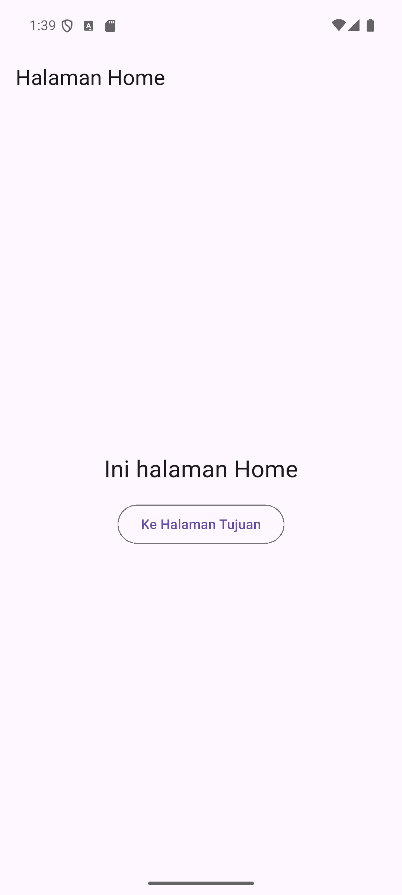
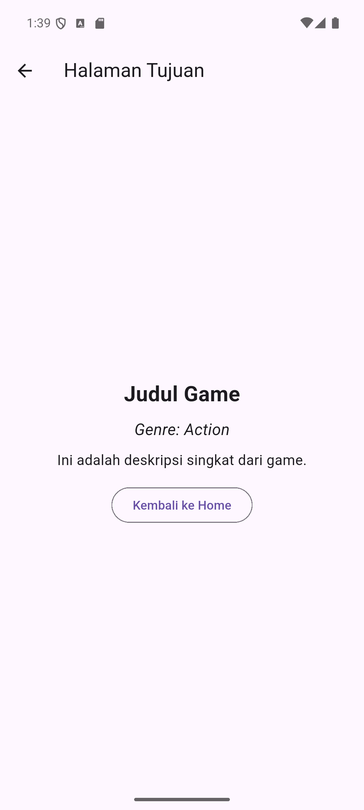
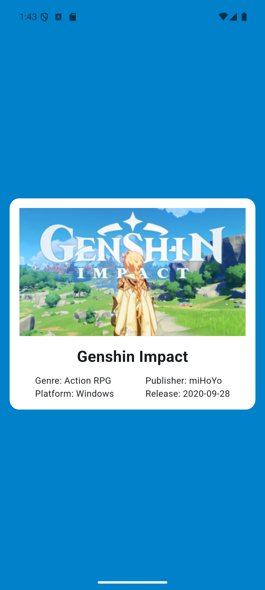
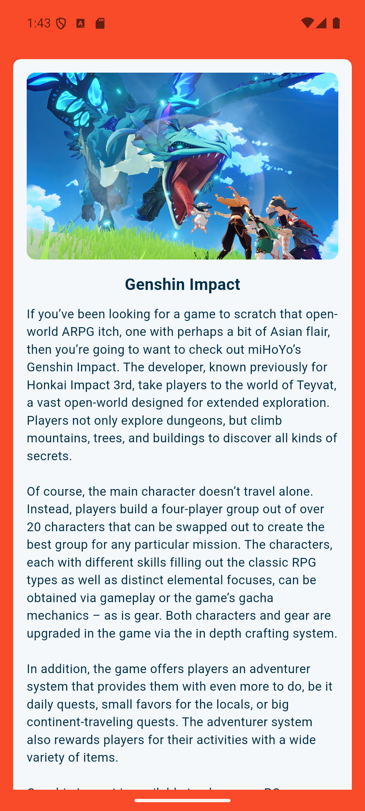
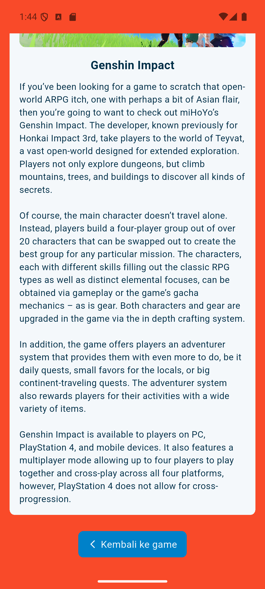

# LAPORAN PRAKTIKUM PEMROGRAMAN MOBILE
## MODUL VIII: Navigasi Antar Halaman dengan Mengirimkan Argumen Menggunakan Named Route

---

### A. Cover
- **Judul Praktikum / Tugas:** Navigasi Antar Halaman dengan Mengirimkan Argumen Menggunakan Named Route
- **Nama Praktikan:** [NAMA PRAKTIKAN]
- **NIM:** [NIM PRAKTIKAN]
- **Kelas:** [KELAS PRAKTIKAN]
- **Program Studi:** [PROGRAM STUDI]
- **Tanggal Praktikum:** 25 September 2026

---

### B. Tujuan Praktikum
1. Mengimplementasikan navigasi antar halaman pada Flutter menggunakan mekanisme *Named Route* (`Navigator.pushNamed`).
2. Mengirim data dari halaman asal (*Home*) menuju halaman tujuan (*Tujuan*) melalui properti `arguments` berbasis objek POJO/PODO (`ScreenArguments`).
3. Mengakses dan mengekstraksi data argumen pada halaman tujuan menggunakan `ModalRoute.of(context)!.settings.arguments`.
4. Mengimplementasikan pengambilan data (*data fetching*) dinamis dari REST API (FreeToGame API) menggunakan paket `http` serta menampilkannya dalam antarmuka terstruktur (*card layout*).
5. Menerapkan penanganan status asynchronous, error jaringan, dan fallback gambar agar aplikasi stabil dan tidak mengalami *crash*.

---

### C. Langkah Kerja Singkat

#### Proyek 1: Langkah Praktikum (`demo_navigasi_namedroute`)
1. **Pembuatan Proyek Flutter:** Membuat proyek Flutter baru bernama `demo_navigasi_namedroute`.
2. **Model Data (`screen_arguments.dart`):** Membuat kelas `ScreenArguments` yang menampung 3 properti: `title`, `subtitle`, dan `description`.
3. **Konfigurasi Rute (`main.dart`):** Mendefinisikan rute awal `initialRoute: '/'` dan memetakan route `'/'` ke widget `Home()` serta `Tujuan.routeName` (`'/tujuan'`) ke widget `Tujuan()`.
4. **Halaman Asal (`home.dart`):** Membuat antarmuka bertuliskan "Ini halaman Home" serta tombol `OutlinedButton` "Ke Halaman Tujuan". Pada callback tombol, membuat objek `ScreenArguments` dan memanggil `Navigator.pushNamed(context, Tujuan.routeName, arguments: args)`.
5. **Halaman Tujuan (`tujuan.dart`):** Mengekstraksi data dari `ModalRoute.of(context)?.settings.arguments as ScreenArguments`, menampilkan `title`, `subtitle`, dan `description`, serta menyediakan tombol `OutlinedButton` "Kembali ke Home" yang memicu `Navigator.pop(context)`.

#### Proyek 2: Tugas Mandiri (`navigasi_argumen`)
1. **Pembuatan Proyek Flutter & Dependency:** Membuat proyek Flutter baru bernama `navigasi_argumen` dan menambahkan package `http` pada `pubspec.yaml`, kemudian mengaktifkan izin `android.permission.INTERNET` pada `AndroidManifest.xml`.
2. **Model Data Berisi 4 Atribut (`screen_arguments.dart`):** Membuat kelas `ScreenArguments` dengan properti `cover`, `title`, `description`, dan `shortDesc`.
3. **Konfigurasi Rute & Tema (`main.dart`):** Mengatur `initialRoute: '/'` dan `Tujuan.routeName: (context) => const Tujuan()`, dengan route name `'/extractArguments'`, warna tema `0xFF0081C9`, dan status bar transparan.
4. **Pengambilan Data API (`home.dart`):**
   - Membuat `StatefulWidget` `Home` yang memanggil `getGame('475')` di `initState()`.
   - Mengambil data dari endpoint `https://www.freetogame.com/api/game?id=475` menggunakan `http.get`.
   - Melakukan parsing JSON untuk memperoleh properti game: judul, thumbnail, screenshot pertama, genre, platform, publisher, dan tanggal rilis.
   - Mengatur handling state berupa indikator loading saat data belum siap, penanganan error jaringan, dan fallback gambar bila gagal dimuat.
   - Menampilkan data dalam kartu putih berlatar belakang biru (`#0081C9`).
   - Saat kartu ditekan (`GestureDetector`), berpindah ke halaman tujuan membawa data melalui `ScreenArguments(cover, title, description, shortDescription)`.
5. **Halaman Detail Scrollable (`tujuan.dart`):**
   - Mengambil argumen melalui `ModalRoute.of(context)!.settings.arguments as ScreenArguments`.
   - Menampilkan layout berlatar belakang oranye kemerahan (`#F94A29`), berisi kartu terang (`#F4F8FB`) dengan cover game (`ClipRRect`), judul tebal, deskripsi lengkap, serta tombol "Kembali ke game" berlatar biru yang memicu `Navigator.pop(context)`.
   - Membungkus seluruh tampilan ke dalam `SingleChildScrollView` sehingga konten panjang dapat digulir dengan mulus.

---

### D. Hasil dan Screenshot Tampilan

Semua screenshot di bawah ini diambil langsung dari pengujian aplikasi yang berjalan pada emulator Android (*sdk gphone64 x86_64, Android 16*).

#### 1. Proyek Praktikum (`demo_navigasi_namedroute`)

| Halaman Home | Halaman Tujuan |
| :---: | :---: |
|  |  |
| **Gambar 1.1:** Tampilan awal `Home` dengan teks dan tombol untuk navigasi. | **Gambar 1.2:** Tampilan `Tujuan` yang berhasil menampilkan 3 data argumen dan tombol kembali. |

*Keterangan Alur:*
- Pengguna menekan tombol **"Ke Halaman Tujuan"**.
- Data `ScreenArguments('Judul Game', 'Genre: Action', 'Ini adalah deskripsi singkat dari game.')` dikirim via `pushNamed`.
- Halaman `Tujuan` membaca data dan menampilkannya dengan styling judul besar tebal, subjudul miring, dan deskripsi reguler.
- Menekan **"Kembali ke Home"** mengeksekusi `Navigator.pop(context)` dan kembali ke halaman utama.

---

#### 2. Proyek Tugas Mandiri (`navigasi_argumen`)

| Halaman Home (Katalog Game) | Halaman Detail (Atas) | Halaman Detail (Bawah / Scrolled) |
| :---: | :---: | :---: |
|  |  |  |
| **Gambar 2.1:** Kartu game *Genshin Impact* dari API FreeToGame pada latar `#0081C9`. | **Gambar 2.2:** Detail game pada latar `#F94A29` dengan cover screenshot dan teks deskripsi. | **Gambar 2.3:** Konten digulir hingga ke tombol navigasi "Kembali ke game". |

*Keterangan Alur:*
- Aplikasi mengambil data game ID `475` (*Genshin Impact*) saat pertama kali dibuka.
- Home menampilkan kartu putih berisi cover thumbnail, judul, genre (*Action RPG*), platform (*Windows*), publisher (*miHoYo*), dan release date (*2020-09-28*).
- Kartu ditekan, memicu navigasi ke rute `'/extractArguments'` dengan objek `ScreenArguments` yang membawa URL screenshot utama, judul, deskripsi lengkap, dan deskripsi singkat.
- Halaman detail menampilkan gambar berkualitas tinggi, judul game, dan teks deskripsi lengkap yang dapat di-*scroll* secara responsif.
- Di bagian bawah, tombol **"Kembali ke game"** mengembalikan pengguna ke halaman utama menggunakan `Navigator.pop(context)`.

---

### E. Ringkasan Hasil & Pembahasan

1. **Named Route untuk Navigasi Terpusat:**
   Penggunaan `routes` map pada `MaterialApp` memusatkan pendaftaran seluruh nama halaman (seperti `'/'` dan `'/extractArguments'`). Hal ini membuat kode navigasi lebih rapi dan modular dibandingkan pendekatan route anonymous (`MaterialPageRoute` langsung di setiap widget).

2. **Pengemasan Data dengan Model Arguments (PODO):**
   Dengan membuat kelas `ScreenArguments`, data yang dikirim tidak lagi terpisah-pisah, melainkan terbungkus dalam satu objek bertipe statis (*type-safe*). Hal ini meminimalkan kesalahan saat penambahan atribut baru di masa depan.

3. **Penerimaan Argumen Secara Fleksibel via ModalRoute:**
   Halaman penerima dapat membaca data langsung melalui `ModalRoute.of(context)!.settings.arguments as ScreenArguments` tanpa harus mendefinisikan argumen pada konstruktor widget tujuan, sehingga widget dapat dipanggil langsung dari tabel rute global.

4. **Integrasi REST API Dinamis dan Robustness:**
   Aplikasi berhasil melakukan komunikasi asynchronous dengan REST API FreeToGame menggunakan package `http`, mengonversi respon JSON ke tipe data Dart, serta memproteksi antarmuka dari skenario kegagalan jaringan atau URL gambar bermasalah dengan `errorBuilder` dan handling `mounted`.

5. **Pengalaman Pengguna (UX) yang Konsisten:**
   Penyediaan `SingleChildScrollView` pada halaman tujuan memastikan konten deskripsi game yang panjang tidak menimbulkan error *overflow* (garis kuning-hitam) pada berbagai ukuran layar perangkat mobile.
